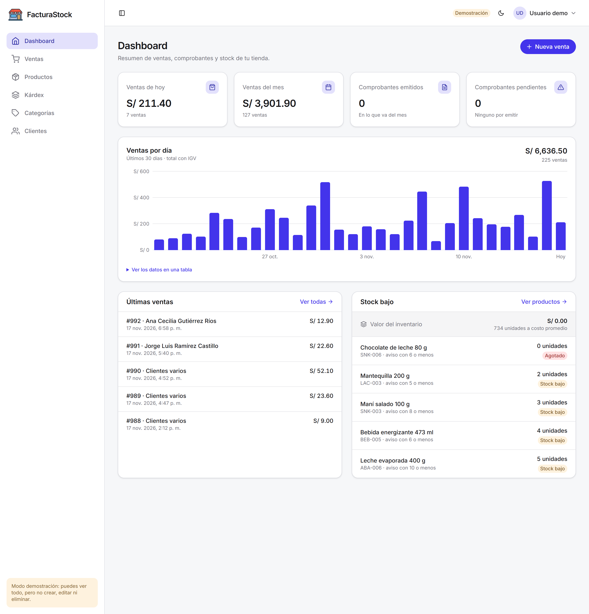
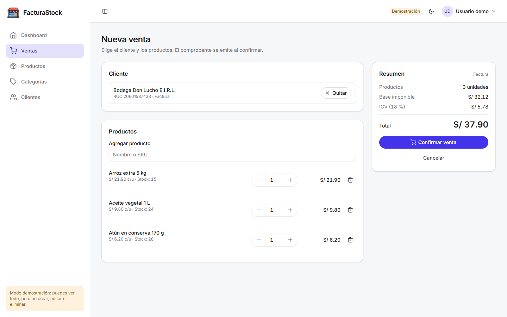
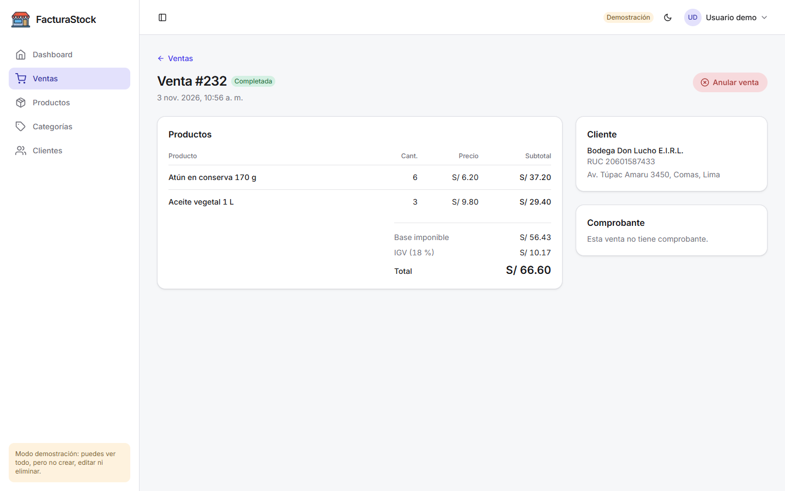
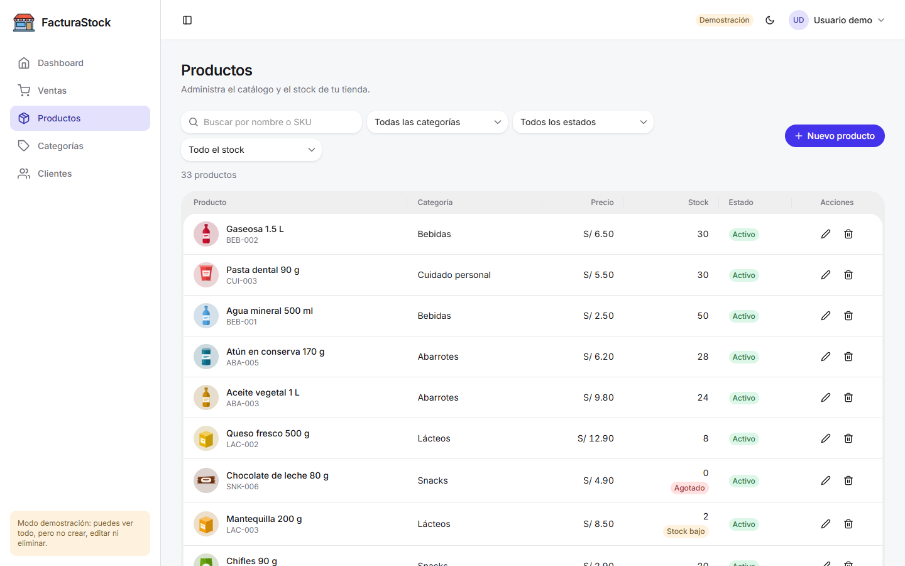
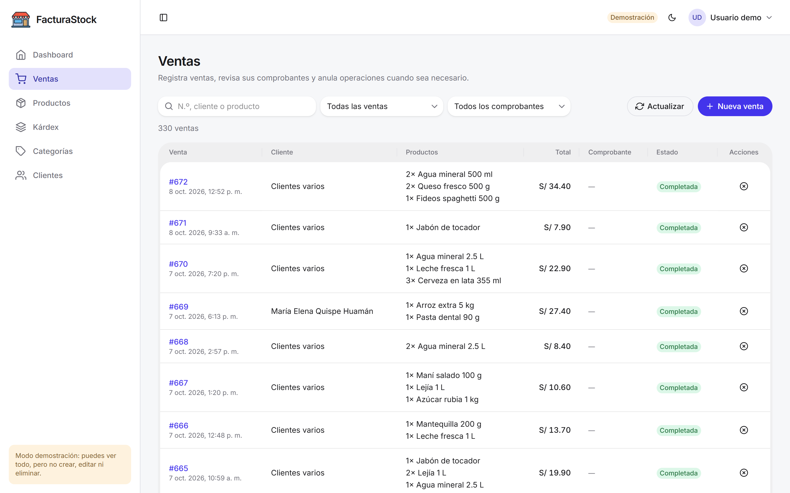
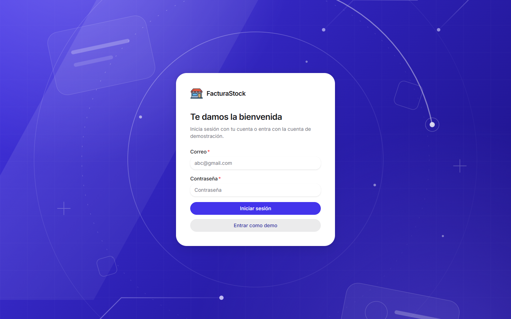
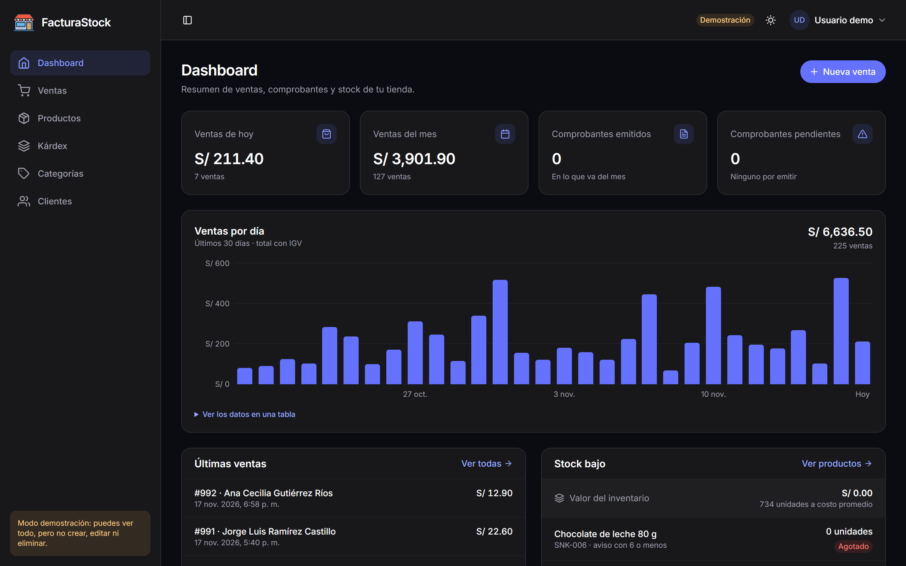
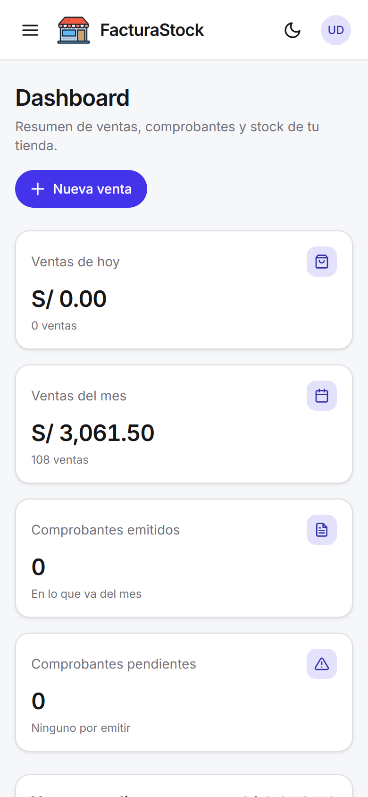
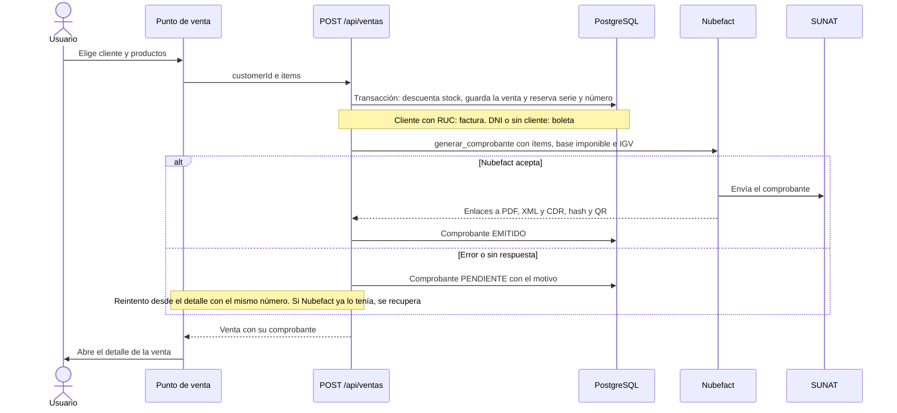

# FacturaStock — Inventario y ventas

Aplicación de inventario y punto de venta construida con **Next.js 16** y **PostgreSQL**. Incluye administración de clientes (DNI/RUC), productos, categorías y ventas, además de la emisión de comprobantes electrónicos (facturas y boletas) mediante **Nubefact**.

**Demo:** [factura-stock.vercel.app](https://factura-stock.vercel.app). Pulsa **Entrar como demo**: no hace falta contraseña. Es una cuenta de solo lectura con datos de ejemplo (ver [Demo pública](#demo-pública)).



| Punto de venta | Detalle de una venta |
| --- | --- |
|  |  |

| Productos | Ventas |
| --- | --- |
|  |  |

| Inicio de sesión | Modo oscuro | Móvil |
| --- | --- | --- |
|  |  |  |

## Funcionalidades

- **Dashboard**
  - Ventas de hoy y del mes, comprobantes emitidos en el mes y comprobantes pendientes de emisión.
  - Gráfico de ventas por día de los últimos 30 días (hora de Lima), con tooltip y vista de tabla.
  - Últimas ventas, productos activos con stock bajo y valor del inventario a costo promedio.
  - Se calcula en el servidor en cada petición; solo cuenta ventas completadas.

- **Clientes**
  - Registro de personas naturales con DNI y empresas con RUC.
  - CRUD con validaciones y paginación; búsqueda por nombre o documento en la API.
  - Consulta de DNI (RENIEC) y RUC (SUNAT) para autocompletar los datos del cliente.
  - Cliente walk-in (`DNI 00000000`) para ventas sin cliente identificado: es un registro del sistema, no aparece en el listado y no se puede editar ni eliminar.

- **Productos**
  - CRUD con SKU único, precio, categoría y estado activo/inactivo. El stock inicial (con su costo, opcional) se indica al crear; después solo cambia con movimientos del kárdex.
  - Imagen del producto subida a Cloudinary (archivo, arrastrar y soltar o URL), guardada en la base y mostrada con un avatar en el listado.
  - Paginación y control de stock. Un producto con movimientos en el kárdex no se elimina: se desactiva.
  - Umbral de stock bajo por producto (5 unidades por defecto): el listado marca los productos agotados o con stock bajo y se puede filtrar por ellos.

- **Kárdex**
  - Un movimiento por cada entrada o salida: saldo inicial, ingresos de mercadería, ajustes positivos y negativos, mermas, ventas, anulaciones y ajustes de valorización.
  - Valorizado por costo promedio ponderado. El costo en los ingresos es opcional (sugiere el último costo); ajustes y mermas usan el promedio vigente y cada venta sale al promedio del momento, sin cambiar el formulario de venta.
  - Vista por producto con filtros de fecha (hora de Lima) y tipo, en dos modos: **Físico** (unidades) y **Valorizado** (unidades y soles), con saldo anterior, totales del periodo y saldo final.
  - Exportación a Excel con la estructura de SUNAT: Formato 13.1 (valorizado) y Formato 12.1 (unidades físicas).
  - Movimientos manuales con motivo obligatorio; el usuario de demostración puede ver y exportar, pero no registrar.

- **Categorías**
  - Módulo propio con tabla paginada, creación y edición.
  - Conteo de productos por categoría.
  - No se puede eliminar una categoría que tenga productos asignados.

- **Ventas**
  - Punto de venta en su propia página (`/admin/ventas/nueva`): buscador de productos y clientes, cantidades editables y desglose de base imponible, IGV y total antes de confirmar. El desglose usa el mismo cálculo que el comprobante.
  - Descuento automático de stock al registrar la venta, como salida del kárdex.
  - Cada venta guarda su base imponible, IGV y total.
  - Página de detalle con las líneas, el estado del comprobante, los enlaces al PDF, XML y CDR, y las acciones de reintentar, anular y consultar la anulación.
  - Anulación con reposición de stock, protegida contra anulaciones simultáneas.
  - Historial paginado con detalle de productos.

- **Comprobantes electrónicos (Nubefact)**
  - RUC → **Factura** (serie `FFF1` por defecto).
  - DNI → **Boleta** (serie `BBB1` por defecto).
  - Series y correlativos iniciales configurables por variables de entorno.
  - Venta sin cliente o walk-in → boleta con documento `-` y número `0`.
  - Precios con IGV incluido (18 %).
  - Emisión automática al registrar la venta.
  - Si Nubefact falla, la venta se guarda y el comprobante queda **PENDIENTE** para reintentar.
  - Anulación del comprobante en Nubefact al anular la venta, con consulta del resultado cuando SUNAT la deja pendiente.
  - Se guardan estado SUNAT, enlaces PDF/XML/CDR, hash, QR y respuesta de Nubefact.

- **Autenticación**
  - Inicio y cierre de sesión con correo y contraseña (Better Auth, sesiones en la base).
  - Roles `ADMIN`, `CASHIER` y `DEMO`: el cajero (cuentas registradas) vende y gestiona clientes; el usuario de demostración solo puede leer (peticiones `GET`).
  - Panel `/admin` y API protegidos; el registro está cerrado por defecto.

- **Interfaz**
  - Pantallas de login y registro con validación en cliente.
  - Panel de administración con sidebar y opción activa resaltada.
  - Imagen de fondo SVG propia en login y registro.

## Stack

| Tecnología | Versión / uso |
| --- | --- |
| Next.js | 16.4.2 (App Router, Turbopack, Cache Components) |
| React | 19.3.0 |
| HeroUI | 3.2.6 |
| Tailwind CSS | 4 (integración con Turbopack) |
| Prisma ORM | 7.10.1 con generador `prisma-client` y `@prisma/adapter-pg` |
| PostgreSQL | 17 |
| Zod | 4.6.7 |
| Nubefact | API JSON v1 para comprobantes electrónicos |

## Requisitos

- Node.js 20.9 o superior
- pnpm
- PostgreSQL 17 (local o con Docker)
- Credenciales de Nubefact para emitir comprobantes reales

## Puesta en marcha

### 1. Instalar dependencias

```bash
pnpm install
```

El `postinstall` ejecuta `prisma generate`.

### 2. Configurar variables de entorno

```bash
cp .env.example .env
# En Windows: Copy-Item .env.example .env
```

Completa los valores en `.env`:

| Variable | Obligatoria | Descripción |
| --- | --- | --- |
| `DATABASE_URL` | Sí | Cadena de conexión de PostgreSQL. |
| `NUBEFACT_API_URL` | Para facturar | URL de la API de Nubefact (incluye el identificador de la cuenta). |
| `NUBEFACT_API_TOKEN` | Para facturar | Token de autenticación de Nubefact. |
| `NUBEFACT_FACTURA_SERIES`, `NUBEFACT_BOLETA_SERIES` | No | Series de la cuenta de Nubefact: 4 caracteres, `F…` para facturas y `B…` para boletas. Por defecto `FFF1` y `BBB1`. |
| `NUBEFACT_FACTURA_INITIAL_NUMBER`, `NUBEFACT_BOLETA_INITIAL_NUMBER` | No | Primer correlativo que se emite con cada serie. Por defecto `8` y `6`. |
| `DECOLECTA_API_TOKEN` | Para consultar documentos | Token de Decolecta para consultar DNI y RUC. |
| `NEXT_PUBLIC_CLOUDINARY_CLOUD_NAME` | Para subir imágenes | Cloud name de Cloudinary (público). |
| `NEXT_PUBLIC_CLOUDINARY_API_KEY` | Para subir imágenes | API key de Cloudinary (público). |
| `CLOUDINARY_API_SECRET` | Para subir imágenes | API secret de Cloudinary. Solo se usa en el servidor, para firmar las subidas y borrar las imágenes que dejan de usarse. |
| `BETTER_AUTH_SECRET` | Sí | Secreto que firma las cookies de sesión. Genera uno con `openssl rand -base64 32`. |
| `BETTER_AUTH_URL` | Sí | URL pública de la aplicación (`http://localhost:3000` en desarrollo). |
| `AUTH_ALLOW_SIGNUP` | No | `true` abre el registro en `/register`. Por defecto está cerrado. |
| `DEMO_USER_EMAIL`, `DEMO_USER_PASSWORD` | No | Credenciales del usuario de demostración (solo lectura). Activan el botón "Entrar como demo" y solo se leen en el servidor. |
| `SEED_ADMIN_EMAIL`, `SEED_ADMIN_PASSWORD` | No | Si se definen, `pnpm db:seed` crea un administrador con esas credenciales. |
| `COMPANY_RUC`, `COMPANY_BUSINESS_NAME`, `COMPANY_ESTABLISHMENT` | En producción, para exportar el kárdex | RUC, razón social y establecimiento de la cabecera del Excel (Formato 13.1). En desarrollo, si faltan, se usan valores de prueba; en producción la exportación falla sin ellos. |
| `DEMO_DATA_ENABLED` | Solo en la demo | `true` permite que la tarea programada regenere los datos de ejemplo. Sin ella, `/api/cron/demo-data` no toca la base. |
| `CRON_SECRET` | Solo en la demo | Secreto con el que Vercel llama a `/api/cron/demo-data`. Genera uno con `openssl rand -hex 32`. |

Sin las variables de Nubefact, las ventas se registran igual y el comprobante queda en estado `PENDIENTE`.

> No subas `.env` al repositorio. Usa `.env.example` como plantilla.

### 3. Levantar PostgreSQL

Con Docker Compose:

```bash
docker compose up -d
```

O apunta `DATABASE_URL` a tu instancia propia.

La base se llama `facturastock`. Si vienes de una versión anterior con la base
`my_inventory`, puedes crear la nueva a partir de la anterior sin perder datos:

```bash
docker compose exec postgres createdb -U postgres -T my_inventory facturastock
```

Después actualiza `DATABASE_URL` en `.env` para que termine en
`/facturastock?schema=public`.

### 4. Aplicar migraciones y datos de ejemplo

```bash
pnpm db:deploy   # aplica las migraciones existentes
pnpm db:seed     # usuarios y datos de ejemplo
```

El seed carga el catálogo de ejemplo (6 categorías, 33 productos con
ilustración, 12 clientes con DNI o RUC y el cliente walk-in) y unas 300 ventas
repartidas en las últimas seis semanas. Restablece los productos y clientes de
ejemplo a sus valores y vuelve a generar las ventas de ejemplo, pero no toca
las ventas que tienen comprobante ni los correlativos de Nubefact. Ver
[Demo pública](#demo-pública).

Además, crea el usuario de demostración (solo lectura) si defines
`DEMO_USER_EMAIL` y `DEMO_USER_PASSWORD`, y un administrador con permisos
completos si defines `SEED_ADMIN_EMAIL` y `SEED_ADMIN_PASSWORD`. Si cambias
alguna de esas contraseñas, vuelve a ejecutar el seed.

### 5. Iniciar el servidor

```bash
pnpm dev
```

Abre [http://localhost:3000](http://localhost:3000).

Inicia sesión con el administrador del seed o con el botón "Entrar como demo".

Verifica la conexión a la base de datos:

```bash
curl http://localhost:3000/api/health/db
```

## Scripts

| Comando | Descripción |
| --- | --- |
| `pnpm dev` | Servidor de desarrollo. |
| `pnpm build` | Genera Prisma y crea el build de producción. |
| `pnpm start` | Inicia el build de producción. |
| `pnpm lint` | Ejecuta ESLint. |
| `pnpm typecheck` | Verifica los tipos con `tsc --noEmit`. |
| `pnpm test` | Ejecuta los tests una vez con Vitest. |
| `pnpm test:watch` | Ejecuta los tests en modo vigilancia. |
| `pnpm db:generate` | Regenera el cliente de Prisma. |
| `pnpm db:validate` | Valida `prisma/schema.prisma`. |
| `pnpm db:migrate` | Crea y aplica una migración en desarrollo. |
| `pnpm db:deploy` | Aplica migraciones pendientes (producción/CI). |
| `pnpm db:push` | Sincroniza el esquema sin crear migraciones. |
| `pnpm db:reset` | Borra y recrea la base, reaplica migraciones y ejecuta el seed. |
| `pnpm db:seed` | Ejecuta `prisma/seed.ts`. |
| `pnpm db:studio` | Abre Prisma Studio. |
| `pnpm demo:images` | Regenera las ilustraciones de los productos de ejemplo en `public/demo/products`. |

Los tests cubren el cálculo de IGV por línea y los totales de los comprobantes
(`tests/nubefact.test.ts`), la protección de la API: 401 sin sesión y 403 para el
usuario de demostración (`tests/auth.test.ts`), la lógica de negocio
(`tests/business-logic.test.ts`), el dashboard (`tests/dashboard.test.ts`) y los
datos de la demo con su tarea programada (`tests/demo-data.test.ts` y
`tests/cron.test.ts`). El flujo de integración continua en
`.github/workflows/ci.yml` ejecuta lint, tipos, tests y build en cada pull
request.

## Rutas de la aplicación

| Ruta | Descripción |
| --- | --- |
| `/` | Login. |
| `/register` | Registro (solo con `AUTH_ALLOW_SIGNUP=true`). |
| `/admin/dashboard` | Indicadores de ventas, comprobantes y stock. |
| `/admin/clientes` | Gestión de clientes. |
| `/admin/productos` | Gestión de productos. |
| `/admin/categorias` | Gestión de categorías. |
| `/admin/ventas` | Historial de ventas. |
| `/admin/ventas/nueva` | Punto de venta. |
| `/admin/ventas/[id]` | Detalle de una venta y su comprobante. |
| `/admin/kardex` | Kárdex por producto (físico y valorizado) y exportación a Excel. |
| `/admin/kardex/nuevo` | Registrar un movimiento manual. |

## API

| Método | Ruta | Descripción |
| --- | --- | --- |
| `GET` / `POST` | `/api/auth/*` | Inicio de sesión, registro, cierre y lectura de sesión (Better Auth). Pública. |
| `GET` | `/api/health/db` | Verifica la conexión con PostgreSQL. Pública; solo responde `ok` o `error`. |
| `GET` / `POST` | `/api/clientes` | Lista paginada y crea clientes. |
| `PUT` / `DELETE` | `/api/clientes/[id]` | Actualiza y elimina un cliente. |
| `GET` | `/api/consulta/dni` | Consulta los datos de un DNI en RENIEC (Decolecta). |
| `GET` | `/api/consulta/ruc` | Consulta los datos de un RUC en SUNAT (Decolecta). |
| `POST` | `/api/cloudinary/signature` | Firma una subida a la carpeta de productos de Cloudinary. |
| `GET` / `POST` | `/api/productos` | Lista paginada y crea productos. |
| `PUT` / `DELETE` | `/api/productos/[id]` | Actualiza (sin tocar el stock) y elimina un producto sin movimientos. |
| `PUT` | `/api/productos/[id]/costo-inicial` | Corrige el costo del saldo inicial mientras sea el único movimiento del producto. |
| `GET` / `POST` | `/api/kardex` | Kárdex de un producto (`productId`, `from`, `to`, `type`, paginado) y registro de un movimiento manual. |
| `GET` | `/api/kardex/export` | Kárdex en `.xlsx` con `mode=fisico` o `mode=valorizado` y los mismos filtros. |
| `GET` / `POST` | `/api/categorias` | Lista paginada y crea categorías. |
| `PUT` / `DELETE` | `/api/categorias/[id]` | Actualiza y elimina una categoría. |
| `GET` / `POST` | `/api/ventas` | Lista paginada y registra ventas (emite comprobante). |
| `POST` | `/api/ventas/[id]/anular` | Anula la venta, repone stock y anula el comprobante. |
| `POST` | `/api/ventas/[id]/comprobante` | Reintenta la emisión de un comprobante pendiente. |
| `POST` | `/api/ventas/[id]/anulacion` | Consulta en Nubefact el resultado de una anulación pendiente y actualiza el comprobante. |
| `GET` | `/api/cron/demo-data` | Mantiene los datos de la demo pública. Solo para la tarea programada de Vercel: exige `Authorization: Bearer $CRON_SECRET`. |

Los mensajes de error se devuelven en español, listos para mostrarse en la interfaz; el campo `error.code` identifica cada caso.

### Búsqueda, filtros y orden

Todos los listados aceptan `page` y `pageSize` (máximo 100), `q` para buscar, y `sort` con `order` (`asc` o `desc`) para ordenar. Cada palabra de `q` debe coincidir con alguno de los campos indicados.

| Listado | `q` busca en | Filtros | `sort` |
| --- | --- | --- | --- |
| `/api/productos` | Nombre, SKU | `categoryId`, `isActive` (`true` o `false`), `lowStock` (`true`: stock menor o igual al umbral del producto) | `createdAt` (por defecto, `desc`), `name`, `sku`, `price`, `stock` |
| `/api/clientes` | Nombres, apellidos, razón social, DNI, RUC, correo | `documentType` (`DNI` o `RUC`) | `createdAt` (por defecto, `desc`), `name`, `document` |
| `/api/categorias` | Nombre, descripción | — | `name` (por defecto, `asc`), `createdAt`, `productCount` |
| `/api/ventas` | Número de venta, serie y número del comprobante, cliente, productos | `status`, `invoiceStatus`, `from` y `to` (`AAAA-MM-DD`, hora de Lima, ambos inclusive) | `createdAt` (por defecto, `desc`), `number`, `total` |

Ejemplo: `GET /api/productos?q=agua&isActive=true&sort=name&order=asc&pageSize=8` es la consulta que hace el buscador de productos del formulario de venta.

Un parámetro con un valor no admitido responde `400` con el detalle en `error.details`.

Salvo `/api/auth/*`, `/api/health/db` y `/api/cron/*` (que se autentica con `CRON_SECRET`), todos los endpoints exigen sesión:
responden `401` sin ella y `403` cuando el usuario de demostración intenta algo
que no sea una lectura. Las consultas de DNI y RUC están limitadas a 10 por
minuto por usuario.

## Facturación electrónica

La integración vive en:

- `src/lib/nubefact.ts`: cliente HTTP, cálculo de IGV, payload, consulta y anulación.
- `src/lib/api/invoice.ts`: emisión, reintento y recuperación de comprobantes existentes.
- `app/api/ventas/route.ts`: reserva del correlativo y creación de la venta.

Flujo de emisión de una venta:



La venta nunca depende de Nubefact: si la emisión falla, el stock ya está
descontado y el comprobante queda pendiente con su número reservado.

Estados del comprobante:

| Estado | Significado |
| --- | --- |
| `PENDIENTE` | No se pudo emitir todavía; se puede reintentar. |
| `EMITIDO` | Aceptado por Nubefact/SUNAT; incluye enlaces y respuesta. |
| `ANULADO` | Comprobante anulado. |
| `ANULACION_PENDIENTE` | Nubefact devolvió un ticket de anulación pendiente de confirmación. |

SUNAT procesa las anulaciones de forma asíncrona. Mientras el comprobante está en `ANULACION_PENDIENTE`, la tabla de ventas muestra el botón **Actualizar estado**, que consulta el resultado en Nubefact (`consultar_anulacion`) y lo pasa a `ANULADO` cuando SUNAT acepta la baja.

Los correlativos se guardan en `invoice_counters` y se reservan en la misma transacción que crea la venta. El reintento reutiliza la serie y el número ya asignados.

Las series salen de `NUBEFACT_FACTURA_SERIES` y `NUBEFACT_BOLETA_SERIES`. La primera vez que se emite con una serie, el correlativo empieza en `NUBEFACT_*_INITIAL_NUMBER`; a partir de ahí manda la fila de `invoice_counters`, así que cambiar la variable después no mueve un correlativo ya iniciado.

Cada venta guarda `taxable_amount` (base imponible) e `igv_amount`, calculados con el mismo redondeo por línea que se envía a Nubefact, de modo que base + IGV = total.

Al anular, el cambio de estado de la venta es condicional (`UPDATE … WHERE status = 'COMPLETADA'`) y el stock solo se repone si esa actualización afectó una fila: dos anulaciones simultáneas no lo reponen dos veces.

## Kárdex

Toda entrada o salida de stock pasa por `recordMovement` (`src/lib/kardex/engine.ts`), dentro de la transacción de quien la origina. El motor bloquea la fila del producto (`SELECT … FOR UPDATE`), calcula el nuevo saldo, inserta el movimiento en `stock_movements` con el siguiente correlativo del producto y actualiza `stock`, `average_cost`, `inventory_value` y `last_cost`. Ningún otro código escribe esas columnas, y el correlativo único por producto hace fallar dos escrituras simultáneas en lugar de descuadrar el saldo.

| Tipo | Dirección | Tabla 12 SUNAT | Costo unitario |
| --- | --- | --- | --- |
| Saldo inicial | Entrada | 16 | El indicado o el último costo |
| Ingreso | Entrada | 99 (02 cuando venga de una compra) | El indicado o el último costo |
| Ajuste positivo | Entrada | 99 | Promedio vigente |
| Venta | Salida | 01 | Promedio vigente |
| Anulación de venta | Entrada | 05 | El de la salida original |
| Ajuste negativo / Merma | Salida | 99 / 13 | Promedio vigente |
| Ajuste de valorización | Sin unidades | 99 | Nuevo costo promedio |

Cada fila guarda el saldo después del movimiento (cantidad, costo promedio y valor), así el saldo anterior a cualquier fecha se lee sin recalcular. Al llegar a 0 unidades el valor se fuerza a 0 para no dejar céntimos residuales. Los movimientos llevan una referencia (`reference_type`, `reference_id`) pensada para que un futuro módulo de compras inserte sus ingresos en el mismo motor.

La migración `add_stock_movements` crea un saldo inicial a costo 0 por cada producto con stock. Mientras sea su único movimiento, su costo se corrige desde el kárdex; después, con un ajuste de valorización.

La referencia es la documentación de la API JSON de Nubefact (versión 1), que Nubefact entrega con la cuenta.

## Imágenes de productos

Las imágenes se eligen desde el formulario de productos de tres formas: subiendo un archivo (`JPG`, `PNG` o `WebP` de hasta 5 MB), arrastrándolo sobre el área de imagen o pegando una URL pública. En los tres casos la imagen se almacena en la carpeta `facturastock/products` de Cloudinary.

La subida es **firmada**: el navegador pide la firma a `POST /api/cloudinary/signature` y envía el archivo (o la URL remota) a la API de subida de Cloudinary con esa firma. El servidor fija la carpeta y el `timestamp` que firma, así que la firma no sirve para otra carpeta ni para otros parámetros. El `CLOUDINARY_API_SECRET` nunca sale del servidor. La URL segura y el `public_id` se guardan en `products.image_url` e `products.image_public_id`, y el listado los muestra con un `Avatar` de HeroUI.

Al reemplazar o quitar la imagen de un producto, o al eliminar el producto, el servidor borra la imagen anterior de Cloudinary. Solo borra archivos de la carpeta `facturastock/products` que ningún otro producto use. Si Cloudinary falla, el cambio en la base se conserva y el error queda en el log del servidor. Una imagen subida en un formulario que se cierra sin guardar sí queda en Cloudinary.

## Demo pública

La demo de [factura-stock.vercel.app](https://factura-stock.vercel.app) está
pensada para que cualquiera la recorra sin poder romperla:

- **Solo lectura.** El botón **Entrar como demo** inicia sesión con una cuenta
  de rol `DEMO`: puede ver todo, pero la API responde `403` a cualquier
  petición que no sea de lectura. Así nadie consume correlativos de Nubefact,
  imágenes de Cloudinary ni consultas de Decolecta.
- **Datos de ejemplo** (`src/lib/demo-data`): 33 productos de 6 categorías con
  ilustraciones propias en `public/demo/products` (SVG generados por
  `pnpm demo:images`, sin fotos de terceros), 12 clientes ficticios con DNI o
  RUC, y unas 300 ventas repartidas en las últimas seis semanas, con más
  movimiento los fines de semana. Algunos productos están agotados o con stock
  bajo para que el dashboard lo muestre. Nombres, documentos y direcciones son
  inventados. Los RUC tienen un dígito verificador válido y los correos usan
  `example.com`.
- **Siempre al día.** Una tarea programada de Vercel (`vercel.json`) llama
  cada hora a `/api/cron/demo-data`. La primera ejecución de cada día
  restablece el catálogo y regenera la historia para que termine hoy. Las
  demás agregan las ventas de ejemplo de la última hora, así «Ventas de hoy»
  avanza durante el día. Cada día genera siempre las mismas ventas: se calculan
  con una semilla que sale de la fecha.
- **Las ventas reales no se tocan.** Las ventas de ejemplo son las únicas sin
  comprobante. Las que registra un administrador desde la aplicación (con su
  comprobante en Nubefact) y los correlativos de `invoice_counters` sobreviven a
  cada reinicio. Para que la demo muestre comprobantes reales con PDF, XML y
  CDR, entra como administrador y registra algunas ventas.

## Despliegue (Vercel + Neon)

1. Crea la base en [Neon](https://neon.tech) y aplica las migraciones desde tu
   equipo con `DATABASE_URL` apuntando a ella: `pnpm db:deploy`.
2. Crea el proyecto en Vercel desde el repositorio. El build ejecuta
   `prisma generate && next build`.
3. Define las variables de entorno de [la tabla](#2-configurar-variables-de-entorno)
   en el proyecto de Vercel. Para la demo hacen falta, además de las básicas:
   - `BETTER_AUTH_URL` con la URL pública (`https://factura-stock.vercel.app`).
   - `DEMO_USER_EMAIL` y `DEMO_USER_PASSWORD`: sin ellas el botón
     **Entrar como demo** no aparece.
   - `DEMO_DATA_ENABLED=true` y `CRON_SECRET`.
   - Las credenciales de **prueba** de Nubefact, nunca las de producción.
   - `AUTH_ALLOW_SIGNUP=false`.
4. Carga los datos una vez desde tu equipo, con las mismas
   `DEMO_USER_*` y `SEED_ADMIN_*` que en Vercel: `pnpm db:seed`.
5. Despliega. La tarea programada `demo-data` aparece en la pestaña de Vercel
   del proyecto y se ejecuta cada hora, en el minuto 5, hora de Lima.

Para comprobar que la demo funciona:

```bash
curl https://factura-stock.vercel.app/api/health/db       # {"status":"ok"}
curl -X POST https://factura-stock.vercel.app/api/auth/demo # {"ok":true}
```

## Estructura del proyecto

```text
app/
  admin/            # Dashboard, clientes, productos, categorías y ventas
  api/              # Route Handlers de la API
  register/         # Pantalla de registro
  page.tsx          # Login
proxy.ts            # Comprobación optimista de la cookie de sesión
components/
  admin/            # Sidebar
  categorias/       # Tabla y formularios de categorías
  clientes/         # Tabla y formularios de clientes
  login/            # Formulario de login
  productos/        # Tabla y formularios de productos
  register/         # Formulario de registro
  dashboard/        # Gráfico de ventas por día
  ventas/           # Tabla, punto de venta, detalle y acciones de ventas
prisma/
  migrations/       # Migraciones de la base de datos
  schema.prisma     # Modelos y enums
  seed.ts           # Datos de ejemplo
public/             # Logo, wallpaper, ilustraciones de la demo (demo/products)
scripts/            # Generador de las ilustraciones de la demo
docs/screenshots/   # Capturas del README
src/
  generated/prisma/ # Cliente de Prisma generado (no versionado)
  lib/api/          # Lógica compartida de la API
  lib/demo-data/    # Catálogo, ventas de ejemplo y reinicio de la demo
  lib/types/        # Tipos de dominio del frontend
  lib/validations/  # Esquemas Zod
  lib/prisma.ts     # Instancia compartida de Prisma
  lib/auth.ts       # Configuración de Better Auth
  lib/auth-policy.ts # Roles y reglas de acceso
  lib/api/session.ts # requireSession para los Route Handlers
  lib/nubefact.ts   # Integración con Nubefact
  lib/decolecta.ts  # Consulta de DNI y RUC con Decolecta
```

## Prisma

El cliente generado se escribe en `src/generated/prisma` (ignorado por git) e incluye tipos para todos los modelos. Se regenera con `pnpm install`, `pnpm db:generate` y antes de `pnpm build`.

La instancia compartida vive en `src/lib/prisma.ts`:

```ts
import { prisma } from "@/src/lib/prisma";

const products = await prisma.product.findMany({
  include: { category: true },
  orderBy: { name: "asc" },
});
```

### Modelos

`Customer`, `Category`, `Product`, `Sale`, `SaleItem`, `Invoice`, `InvoiceCounter`
y los de autenticación `User`, `Session`, `Account` y `Verification`
(ver `prisma/schema.prisma`).

### Notas de Prisma 7

- El generador es `prisma-client` y **requiere** `output`; el cliente ya no se genera dentro de `node_modules`.
- No hay motor de Rust: PostgreSQL se conecta mediante el driver adapter `@prisma/adapter-pg` (`pg`), configurado en `src/lib/prisma.ts`.
- `prisma.config.ts` es el archivo de configuración de la CLI y carga `.env` explícitamente con `import "dotenv/config"`.
- Si usas un proveedor con pooler (Neon, Supabase), usa la URL directa para las migraciones (`pnpm db:migrate` / `pnpm db:deploy`).

## Autenticación

La autenticación usa [Better Auth](https://www.better-auth.com) con correo y
contraseña y sesiones guardadas en PostgreSQL.

- **Dos capas.** `proxy.ts` hace una comprobación rápida de la cookie para
  `/admin/*` y `/api/*`. La validación real ocurre después: el layout de
  `/admin` llama a `getCurrentUser()` y cada Route Handler empieza con
  `requireSession(request)`.
- **Roles.** `ADMIN` tiene acceso completo. `CASHIER` es el rol de las cuentas
  registradas: puede ver todo, registrar ventas, emitir comprobantes, crear y
  editar clientes y consultar DNI y RUC. Crear, editar o eliminar productos y
  categorías, eliminar clientes, subir imágenes, registrar movimientos de
  kárdex y anular ventas responde `403 ADMIN_ONLY` (`requireSession(request,
  { adminOnly: true })`). `DEMO` solo puede hacer peticiones `GET`: cualquier
  otro método responde `403 DEMO_READ_ONLY`. Tampoco puede usar las consultas
  de DNI y RUC, porque gastan cuota de Decolecta.
- **Cuenta de demostración.** El botón "Entrar como demo" llama a
  `POST /api/auth/demo`, que inicia la sesión en el servidor con
  `DEMO_USER_EMAIL` y `DEMO_USER_PASSWORD`. Las credenciales no aparecen en la
  página ni en el código del navegador. Sin esas variables, el botón no se
  muestra.
- **Registro.** Cerrado por defecto. Con `AUTH_ALLOW_SIGNUP=true` cada cuenta
  nueva es `CASHIER` y recibe un correo de bienvenida (Resend). Para dar
  permisos de administrador, cambia el rol en la tabla `users`.
- **Endpoints de Better Auth.** Solo se exponen inicio de sesión, registro,
  cierre y lectura de sesión. El resto (cambio de contraseña, de correo...)
  responde `404`, para que nadie cambie la contraseña de la cuenta de
  demostración.

## Limitaciones actuales

- No hay recuperación de contraseña ni gestión de usuarios desde la interfaz.
- El límite de las consultas de DNI y RUC se guarda en memoria, por proceso.
- Solo se emiten facturas y boletas; no hay notas de crédito ni débito.
- La emisión real requiere credenciales válidas de Nubefact.

## Recursos

- [Documentación de Next.js](https://nextjs.org/docs)
- [Documentación de Prisma ORM 7](https://www.prisma.io/docs/orm)
- [Documentación de HeroUI](https://www.heroui.com/docs)
- [Nubefact](https://www.nubefact.com/)
- [Better Auth](https://www.better-auth.com)
